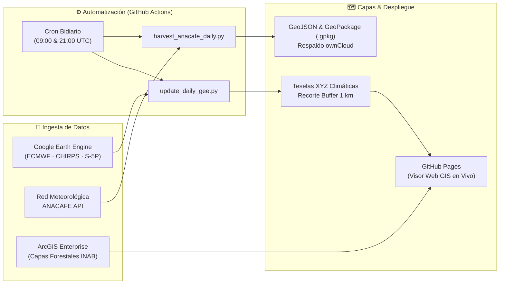

<p align="center">
  <a href="https://sig.inab.gob.gt/" target="_blank">
    
  </a>
</p>

<h1 align="center">Sistema de Monitoreo Climático Forestal</h1>

<p align="center">
  <strong>Coordinación de Sistemas de Información Geográfica (SIG-INAB)</strong><br>
  <em>Instituto Nacional de Bosques de Guatemala</em>
</p>

<p align="center">
  <a href="https://sig-inab.github.io/Monitoreo_climatico_Forestal/" target="_blank">
    
  </a>
  <a href="https://sig.inab.gob.gt/" target="_blank">
    
  </a>
  <a href="https://github.com/sig-inab/Monitoreo_climatico_Forestal/actions/workflows/daily_update.yml">
    
  </a>
  <a href="./LICENSE">
    
  </a>
</p>

<p align="center">
  <a href="https://www.python.org/" target="_blank"></a>
  <a href="https://developers.google.com/earth-engine" target="_blank"></a>
  <a href="https://leafletjs.com/" target="_blank"></a>
  <a href="https://esri.github.io/esri-leaflet/" target="_blank"></a>
  <a href="https://github.com/onursimsek/leaflet-velocity" target="_blank"></a>
  <a href="https://requests.readthedocs.io/" target="_blank"></a>
  <a href="https://www.geopackage.org/" target="_blank"></a>
</p>

---

## Red de Cooperación y Proveedores de Datos

El Sistema de Monitoreo Climático Forestal consolida observaciones meteorológicas de superficie en tiempo real, modelos climáticos globales y sensores remotos orbitales, integrando las siguientes instituciones colaboradoras:

### 🇬🇹 Instituciones Estatales y Redes Nacionales
<table align="center" width="100%">
  <tr>
    <td align="center" width="33%" valign="top">
      <a href="https://sig.inab.gob.gt/" target="_blank">
        <br><br>
        <strong>Instituto Nacional de Bosques (INAB)</strong><br>
        <sub>Coordinación SIG · Geoportal Oficial</sub>
      </a>
    </td>
    <td align="center" width="33%" valign="top">
      <a href="https://insivumeh.gob.gt/" target="_blank">
        <br><br>
        <strong>INSIVUMEH</strong><br>
        <sub>Red Meteorológica, Mareas y Alertas Oficiales</sub>
      </a>
    </td>
    <td align="center" width="33%" valign="top">
      <a href="https://meteorologia.anacafe.org/" target="_blank">
        <br><br>
        <strong>ANACAFE</strong><br>
        <sub>Red Meteorológica de Alta Densidad Agrícola</sub>
      </a>
    </td>
  </tr>
</table>

### 🌐 Proveedores Globales de Datos Satelitales y Modelación Atmosférica
<table align="center" width="100%">
  <tr>
    <td align="center" width="20%" valign="top">
      <a href="https://www.ecmwf.int/" target="_blank">
        <br><br>
        <strong>ECMWF</strong><br>
        <sub>Reanálisis ERA5 y Pronóstico Atmosférico IFS</sub>
      </a>
    </td>
    <td align="center" width="20%" valign="top">
      <a href="https://www.noaa.gov/" target="_blank">
        <br><br>
        <strong>NOAA</strong><br>
        <sub>Satélites GOES & nowCOAST Radar/Nube</sub>
      </a>
    </td>
    <td align="center" width="20%" valign="top">
      <a href="https://www.chc.ucsb.edu/data/chirps" target="_blank">
        <br><br>
        <strong>CHIRPS / UCSB</strong><br>
        <sub>Precipitación Diaria y Anomalías Históricas</sub>
      </a>
    </td>
    <td align="center" width="20%" valign="top">
      <a href="https://sentinels.copernicus.eu/web/sentinel/missions/sentinel-5p" target="_blank">
        <br><br>
        <strong>Copernicus S-5P</strong><br>
        <sub>Química Atmosférica, Monóxido y Aerosoles</sub>
      </a>
    </td>
    <td align="center" width="20%" valign="top">
      <a href="https://earthengine.google.com/" target="_blank">
        <br><br>
        <strong>Earth Engine</strong><br>
        <sub>Cómputo en la Nube y Generación de Teselas</sub>
      </a>
    </td>
  </tr>
</table>

---

## Acerca del Sistema

El **Sistema de Monitoreo Climático Forestal** ha sido concebido y desarrollado por la **Coordinación de Sistemas de Información Geográfica del INAB** con el propósito de proveer una plataforma científica, abierta y en tiempo real para el seguimiento de variables meteorológicas críticas sobre los ecosistemas forestales de Guatemala.

Inspirado en los estándares internacionales de plataformas climáticas (como el [C3S Atlas de Copernicus/ECMWF](https://atlas.climate.copernicus.eu)), el sistema implementa principios de **transparencia, reproducibilidad y principios FAIR** (*Findability, Accessibility, Interoperability, and Reusability*). Su objetivo central es suministrar información espacial de alta resolución a técnicos de campo, investigadores, directores regionales y tomadores de decisiones para:

* **Gestión del Riesgo y Prevención de Incendios Forestales**: Monitoreo de anomalías de temperatura, índices de sequía y vientos.
* **Seguimiento de Incentivos Forestales (PINPEP / PROBOSQUE)**: Evaluación del impacto de episodios meteorológicos extremos sobre proyectos forestales adjudicados.
* **Alertas Tempranas y Salud del Ecosistema**: Análisis de estrés hídrico mediante series de precipitación (CHIRPS) y calidad del aire / dispersión de humo (Copernicus Sentinel-5P).

---

## Estructura del Repositorio

La arquitectura del repositorio está organizada de forma modular para garantizar la interoperabilidad entre los procesos de ingesta de datos, los flujos de integración continua y el visor cartográfico:

| Directorio / Archivo | Descripción |
| :------------------- | :---------- |
| [`.github/workflows/`](./.github/workflows) | Workflows de GitHub Actions para ejecución automática bidiaria (`daily_update.yml`). |
| [`scripts/`](./scripts) | Scripts automatizados en Python para ingesta satelital en GEE y recolección concurrente de estaciones terrestres (`update_daily_gee.py`, `harvest_anacafe_daily.py`). |
| [`skills/`](./skills) | Habilidades y playbooks técnicos de IA integrados para teledetección, rendimiento de código, CI/CD y diseño cartográfico. |
| [`assets/logos/`](./assets/logos) | Identidad visual oficial de instituciones nacionales e internacionales proveedoras de datos. |
| [`index.html`](./index.html) | Aplicación principal Web GIS en producción servida a través de GitHub Pages. |
| [`inab-interactivo-tierra.html`](./inab-interactivo-tierra.html) | Módulo dinámico interactivo con simulación de partículas de la Tierra y constelaciones de monitoreo orbital. |

---

## Flujo de Procesamiento Automatizado



1. **Planificación Automatizada**: GitHub Actions activa dos veces al día (`0 9,21 * * *`) el pipeline de actualización sin intervención humana.
2. **Procesamiento Orbital**: `update_daily_gee.py` se autentica con Google Earth Engine, filtra las imágenes más recientes de precipitación, temperatura y viento, genera las URL de teselas raster y las recorta al buffer oficial de 1 km de la República de Guatemala.
3. **Cosecha de Estaciones Terrestres**: `harvest_anacafe_daily.py` extrae en paralelo las lecturas de estaciones activas, calcula anomalías térmicas y acumulación pluviométrica, generando capas vectoriales estándar GeoJSON y GeoPackage (`.gpkg`).
4. **Despliegue Continuo**: Las nuevas capas y parámetros se sincronizan automáticamente con `index.html` y se publican al instante en [GitHub Pages](https://sig-inab.github.io/Monitoreo_climatico_Forestal/).

---

## Librerías y Tecnologías Utilizadas

Siguiendo el esquema técnico de reproductibilidad científica, a continuación se detallan las principales librerías utilizadas en la plataforma:

| Librería / Componente | Descripción |
| :-------------------- | :---------- |
| [**earthengine-api**](https://developers.google.com/earth-engine) | API cliente oficial de Google Earth Engine en Python para consulta, procesamiento distribuido y exportación de teselas climáticas. |
| [**Leaflet**](https://leafletjs.com/) | Biblioteca JavaScript líder de código abierto para mapas interactivos ligeros y adaptables a dispositivos móviles. |
| [**Esri Leaflet**](https://esri.github.io/esri-leaflet/) | Complemento para Leaflet que permite consumir directamente servicios REST de ArcGIS (FeatureLayers, MapServers y renderizadores oficiales). |
| [**Leaflet Velocity**](https://github.com/onursimsek/leaflet-velocity) | Motor de renderizado en Canvas para visualización fluida y animada de campos vectoriales de dirección y velocidad de viento. |
| [**Requests**](https://requests.readthedocs.io/) | Cliente HTTP para Python utilizado en la ingesta concurrente de APIs meteorológicas mediante `concurrent.futures`. |
| [**OGC GeoPackage & SpatiaLite**](https://www.geopackage.org/) | Estándar abierto geoespacial basado en SQLite para almacenamiento atómico y preservación histórica de mediciones meteorológicas. |
| [**FontAwesome 6**](https://fontawesome.com/) | Conjunto iconográfico para la señalética meteorológica, controles de capas y botones de acción rápida. |

---

## Requisitos y Configuración Local

Para replicar o ejecutar los scripts de procesamiento en un entorno local:

```bash
# 1. Clonar el repositorio
git clone https://github.com/sig-inab/Monitoreo_climatico_Forestal.git
cd Monitoreo_climatico_Forestal

# 2. Crear y activar entorno virtual
python3 -m venv .venv
source .venv/bin/activate

# 3. Instalar dependencias requeridas
pip install earthengine-api requests

# 4. Configurar credenciales de Google Earth Engine
export GEE_SERVICE_ACCOUNT_KEY='{"type": "service_account", ...}'

# 5. Ejecutar la actualización diaria
python scripts/update_daily_gee.py
python scripts/harvest_anacafe_daily.py
```

---

## Módulos de Soporte y Skills del Proyecto

El repositorio incorpora una suite de **11 skills especializados** en la carpeta [`skills/`](./skills) para garantizar la calidad del software y el análisis geoespacial:

* **Teledetección**: `radar-satellite-analysis`, `noaa-radar-satellite-fetching`, `nexrad-radar-visualization`.
* **Ingeniería de Datos**: `data-engineering-data-pipeline`, `python-performance-optimization`, `python-testing-patterns`.
* **CI/CD y DevOps**: `github-actions-debugger`, `github-actions-advanced`.
* **Cartografía y UX**: `command-center-ui`, `dashboard-design`.
* **Seguridad de Despliegue**: `client-secret-exposure-audit`.

---

## Créditos y Administración Institucional

* **Institución Responsable**: [Instituto Nacional de Bosques (INAB)](https://inab.gob.gt/), Guatemala.
* **Unidad Técnica**: Coordinación de Sistemas de Información Geográfica (SIG-INAB).
* **Geoportal Oficial**: [sig.inab.gob.gt](https://sig.inab.gob.gt/)

## Licencia

Este proyecto se distribuye bajo la licencia **MIT** — consulta el archivo [LICENSE](./LICENSE) para más detalles. Las capas de datos climáticos provienen de sus respectivas entidades emisoras y se rigen por las políticas de datos abiertos de cada institución proveedora.
